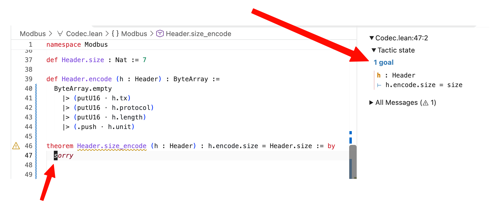
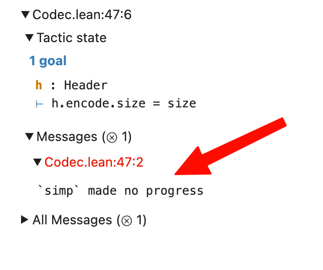
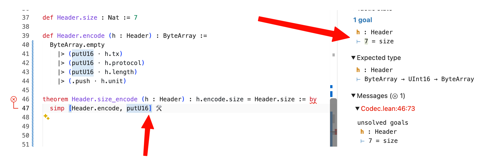
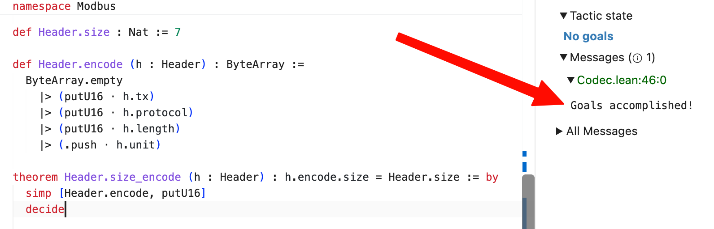
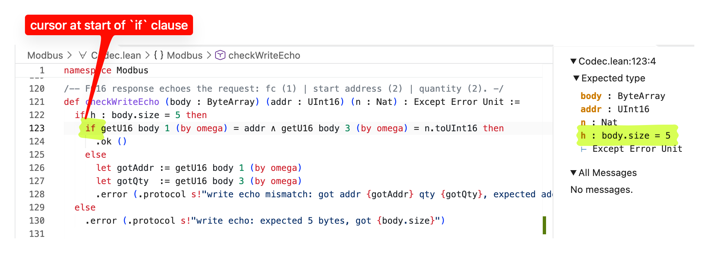
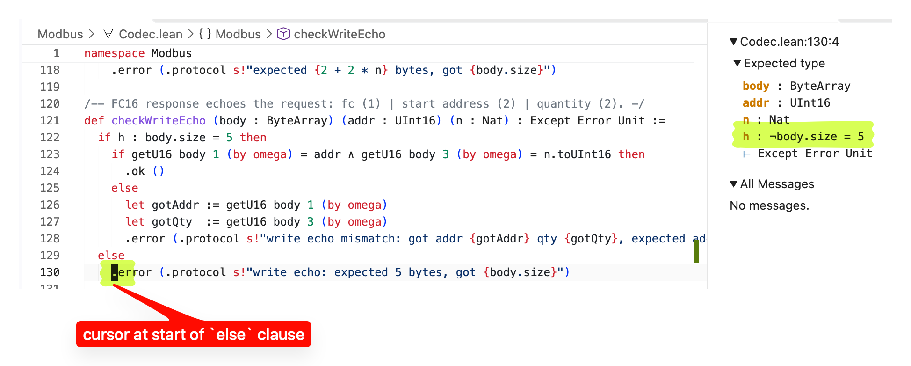
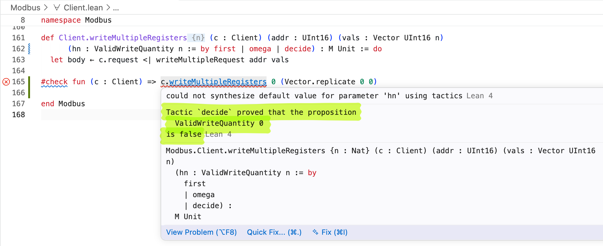
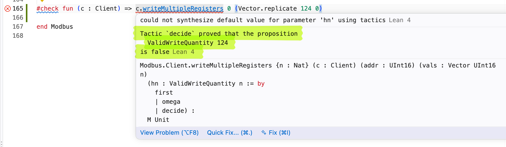

What better way to learn Lean, than to implement a bespoke home battery
management system? I'm going to do that in this series of blog posts, porting my
[Go implementation](https://carlo-hamalainen.net/2026/06/12/sungrowd-go) over to
Lean4.
The UI will naturally use the [Lean Datastar SDK](https://data-star.dev/reference/sdks#lean) that
I developed with [Valentin Erokhin](https://github.com/saviorand). Also check out <https://leangineer.com> 🙂

I couldn't find a Modbus library in Lean, but it's a fairly simple protocol, so I wrote my own from scratch.
First we need a [header type](https://en.wikipedia.org/wiki/Modbus#Modbus_TCP):

```lean
structure Header where
  tx       : UInt16
  protocol : UInt16
  length   : UInt16
  unit     : UInt8
  deriving Repr, BEq
```

The fields:

* `tx`: client chooses and the server echoes back; used for synchronisation.
* `protocol`: the protocol identifier; for Modbus/TCP this is always zero.
* `length`: Number of remaining bytes in this frame.
* `unit`: Server address. For Sungrow this seems to be 1 by default.

## Encoding the header and proving its size

Here's a small helper for appending a 16-bit word to a `ByteArray` (Modbus is big-endian).

```lean
def putU16 (b : ByteArray) (v : UInt16) : ByteArray :=
  let vHigh := (v >>> 8).toUInt8
  let vLow  := v.toUInt8
  b.push vHigh |>.push vLow
```

Now we can define the encoder which converts a `Header` to a `ByteArray`:

```lean
def Header.encode (h : Header) : ByteArray :=
  ByteArray.empty
    |> (putU16 · h.tx)
    |> (putU16 · h.protocol)
    |> (putU16 · h.length)
    |> (.push · h.unit)
```

The quirky dot notation `·` is a nice shorthand for what one would write in Haskell as `\x -> putU16 x h.tx`.
Perhaps taking inspiration from F#, Lean has some nice pipe operators like `|>` where
`x |> f` means the same as `f x`, and it associates to the left so that `x |> f |> g` is 
`g (f x)`.

We declare that the size of `Header` is 7 bytes:

```lean
def Header.size : Nat := 7
```

Magic numbers like this are always fun in huge codebases. Someone adds a field
to `Header`, and then everything explodes. So let's prove that `Header` has size
7!

```lean
theorem Header.size_encode (h : Header) : h.encode.size = Header.size := by
  sorry
```

We are declaring a theorem `size_encode` on `Header`; its one hypothesis is that `h` is a 
`Header` and the goal is that `h.encode.size = Header.size`. We don't know what to do so we
write `sorry` for the proof body.

If you put the cursor at the start of `sorry`, the Lean Info View will show the current tactic state:



We know that `h` is a `Header`, and we need to show that `h.encode.size = size`. 

First let's try the simplifier [simp](https://lean-lang.org/doc/reference/latest/Tactic-Proofs/Tactic-Reference/#simp):

```lean
theorem Header.size_encode (h : Header) : h.encode.size = Header.size := by
  simp
```

This doesn't help:



If you were doing this with pen and paper, you'd make the first (and only?) sensible 
move which is to expand the definition of `Header.encode`, so let's try that:

```lean
theorem Header.size_encode (h : Header) : h.encode.size = Header.size := by
  simp [Header.encode]
```

Progress!

```
1 goal
h : Header
⊢ (putU16 (putU16 (putU16 ByteArray.empty h.tx) h.protocol) h.length).size + 1 = size
```

Again our only move is to expand a definition, so we add `putU16` to the `simp` tactic:

```lean
theorem Header.size_encode (h : Header) : h.encode.size = Header.size := by
  simp [Header.encode, putU16]
```

We are tantalisingly close:



We literally defined `Header.size := 7` and the goal is to prove that `7 = size`, so it just needs one more nudge using 
[decide](https://lean-lang.org/doc/reference/latest/Tactic-Proofs/Tactic-Reference/#decide):


```lean
theorem Header.size_encode (h : Header) : h.encode.size = Header.size := by
  simp [Header.encode, putU16]
  decide
```

Success!



That's pretty cool.

The rest of the codec is in <https://github.com/carlohamalainen/sungrowd-lean/blob/main/Modbus/Codec.lean>.


## Reading U16 words and proving bounds

Here's a helper for reading 16-bit words from a `ByteArray` response that we received from the inverter:

```lean
def getU16 (b : ByteArray) (i : Nat) (h : i + 1 < b.size): UInt16 :=
  let vHigh := b[i].toUInt16
  let vLow  := b[i + 1].toUInt16
  (vHigh <<< 8) ||| vLow
```

The third argument to the function is a proof that `i + 1 < b.size`, which ensures that `b[i + 1]` is safe.

One of the most "exciting" bugs I saw in a C++ codebase at a previous job was
due to unsafe lookups into vectors (using `x[i]` instead of `x.at(i)`). The
function would work perfectly fine on any of 100 inputs individually, but if you
ran the 100 calculations in a sequence it would segfault. Some pushback from an older C++ person was that "using `x.at(i)` is slow".
But in Lean this proof is checked at compile time and then erased, so the lookup compiles to a plain unchecked read.

This works:

```lean
#eval getU16 (ByteArray.mk #[0xAA, 0xBB]) 0 (by decide)
```

but 

```lean
#eval getU16 (ByteArray.mk #[0xAA, 0xBB]) 1 (by decide)
```

produces an error:

```
Tactic `decide` proved that the proposition
  1 + 1 < { data := #[170, 187] }.size
is false
```

That's fine for a static array and offset, but what about an offset into an arbitrary `ByteArray`?

In the `checkWriteEcho` function we are hoping for a `ByteArray` of size 5. The `if` statement
isn't a normal boolean test like in other languages; it is a "dependent" if and the named 
proof `h : body.size = 5` is in scope for the `then` clause but not the `else` clause.

```lean
def checkWriteEcho (body : ByteArray) (addr : UInt16) (n : Nat) : Except Error Unit :=
  if h : body.size = 5 then
    if getU16 body 1 (by omega) = addr ∧ getU16 body 3 (by omega) = n.toUInt16 then
      .ok ()
    else
      let gotAddr := getU16 body 1 (by omega)
      let gotQty  := getU16 body 3 (by omega)
      .error (.protocol s!"write echo mismatch: got addr {gotAddr} qty {gotQty}, expected addr {addr} qty {n}")
  else
    .error (.protocol s!"write echo: expected 5 bytes, got {body.size}")
```

Compare



and



The Modbus protocol specifies that we can write at most 123 registers in a single request. We can encode this
as `ValidWriteQuantity`:

```lean
/-- Maximum number of registers that one FC16 write may carry (spec 0x7B),
so the byte count fits in a `UInt8`. -/
abbrev maxWriteQuantity : Nat := 123

/-- `n` is a legal register count for one FC16 write. -/
abbrev ValidWriteQuantity (n : Nat) : Prop := 1 ≤ n ∧ n ≤ maxWriteQuantity
```

I'll skip the details of constructing the raw request, and just mention that the high level function for writing multiple registers
can be sure that its supplied vector of values is within the acceptable size (see [Client.lean](https://github.com/carlohamalainen/sungrowd-lean/blob/main/Modbus/Client.lean)):

```lean
def Client.writeMultipleRegisters (c : Client) (addr : UInt16) (vals : Vector UInt16 n)
      (hn : ValidWriteQuantity n := by first | omega | decide) : M Unit := do
  let body ← c.request <| writeMultipleRequest addr vals
  ofExcept (checkWriteEcho body addr vals.size)
```

We get an error if we try to pass an empty vector:



Calls with a vector in the correct range work, for example

```lean
#check fun (c : Client) => c.writeMultipleRegisters 0 (Vector.replicate 100 0)
```

And if we go over, error:



## Reading a live value

In [Main.lean](https://github.com/carlohamalainen/sungrowd-lean/blob/main/Main.lean) we read register 
5007 which has the inverter's temperature in degrees Celsius, signed 16-bit, with one implied decimal.

It works 🙂

```shell
❯ lake build && SUNGROWD_DEBUG=1 .lake/build/bin/sungrowd
Build completed successfully (8 jobs).
TX 00 00 00 00 00 06 01 | 04 13 8f 00 01   mbap tx=0 len=6 unit=1
RX 00 00 00 00 00 05 01 | 04 02 01 60   mbap tx=0 len=5 unit=1
inverter temperature: 35.2 °C  (raw 352)
```

## Next steps

The Modbus layer is done, so the next part moves up a level to the Sungrow-specific code:

* **Named registers.** Replace raw addresses with a typed register table, so reading the
  battery state of charge or the grid power is a function call rather than a magic number.
  The addresses come from the same
  [HomeAssistant YAML](https://github.com/mkaiser/Sungrow-SHx-Inverter-Modbus-Home-Assistant/blob/main/modbus_sungrow.yaml)
  that the Go version used.
* **Typed control values.** The battery command register takes one of three magic values
  for charge, discharge and stop. These can be encoded as an inductive type with a round-trip theorem.
* **Testing writes against the real inverter.** The write echo check from this post is the
  safety net. The next part will test writes on the control registers (EMS mode, command, forced power).
* **Chunked reads.** The Go version groups contiguous registers into blocks to cut down on
  round trips; the Lean version will do the same, with the block sizes proved valid.