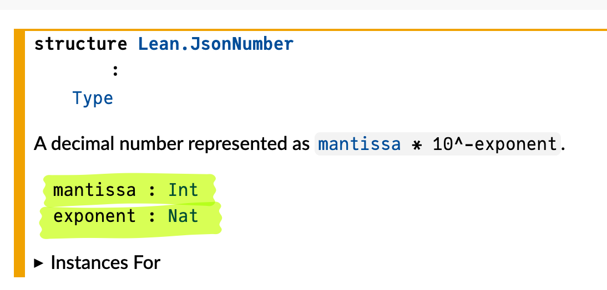
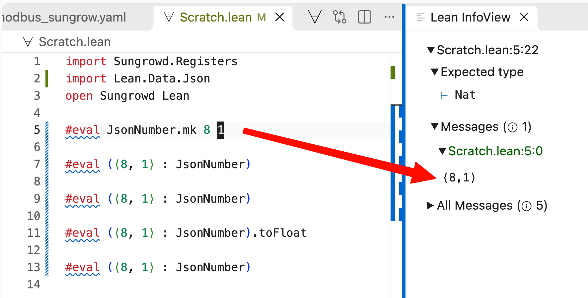
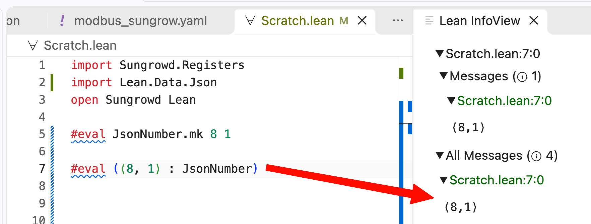
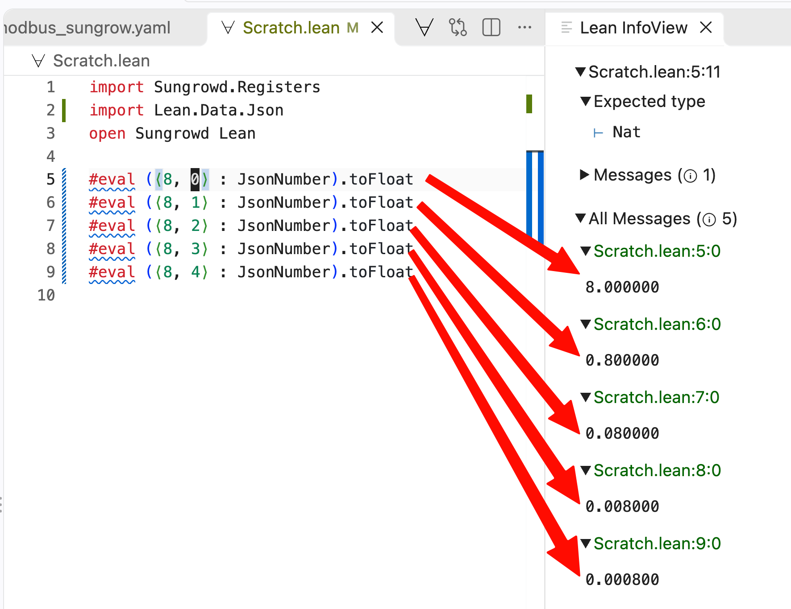
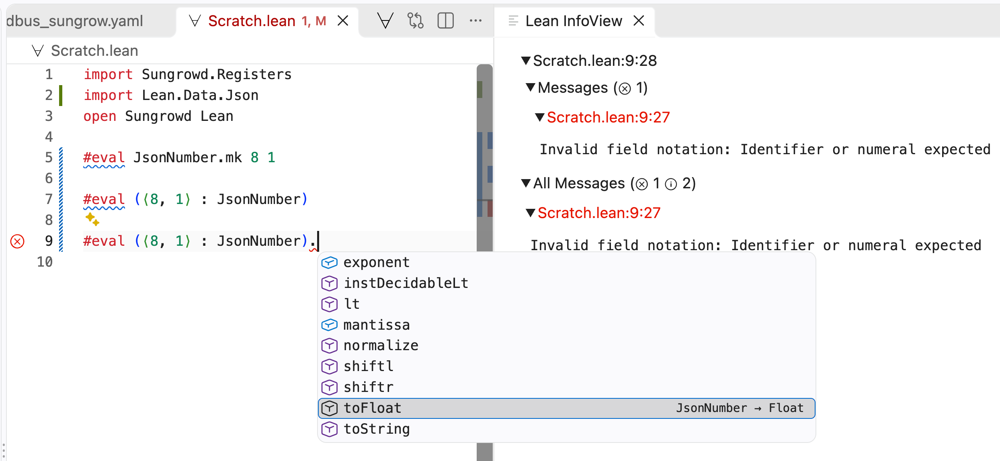

In [part 1](https://carlo-hamalainen.net/2026/10/16/sungrow-lean-part1/) we
implemented a simple Modbus TCP library and read a single sensor from the
Sungrow inverter. Our next step is to parse the full list of registers so that
we can read all the values of interest like real time solar production,
battery state of charge, grid draw, etc.

## YAML and JSON data

As with the Go implementation we will lean on the good work of the Home
Assistant developers who have published YAML data of the Sungrow inverter
registers: [modbus_sungrow.yaml](https://github.com/mkaiser/Sungrow-SHx-Inverter-Modbus-Home-Assistant/blob/main/modbus_sungrow.yaml)

The structure of the file is a top level `modbus` section containing one `hub` with a list of sensors. 
There are a lot of sensors in this file, so here's a cut down sample showing just one, the solar DC power in Watts:

```yaml
modbus:
  - name: &sg_hub_name SungrowSHx
    type: tcp
    host: !secret sungrow_modbus_host_ip
    port: !secret sungrow_modbus_port
    delay: 15 # delay 5 second after connecting
    timeout: 30 # timeout while waiting for a response before flodding the log with errors
    message_wait_milliseconds: !secret sungrow_modbus_wait_milliseconds # delay between messages, depending on inverter connection

    sensors:

      - name: Total DC power
        unique_id: sg_total_dc_power
        device_address: !secret sungrow_modbus_device_address
        address: 5016 # reg 5017
        input_type: input
        data_type: uint32
        swap: word
        precision: 0
        unit_of_measurement: W
        device_class: power
        state_class: measurement
        scale: 1
        scan_interval: *scan_interval_fast
```

This tells us to look at address 5016 (0-indexed) for a 32-bit unsigned integer, with units W (Watts). At the time of writing I couldn't
find a Lean YAML library so I did a one-off conversion to JSON using a 
[Python script](https://github.com/carlohamalainen/sungrowd-lean/blob/main/scripts/yaml_to_json.py).

The entry above becomes:

```json
{
  "modbus": [
    {
      "name": "SungrowSHx",
      "type": "tcp",
      "host": "sungrow_modbus_host_ip",
      "port": "sungrow_modbus_port",
      "delay": 15,
      "timeout": 30,
      "message_wait_milliseconds": "sungrow_modbus_wait_milliseconds",
      "sensors": [

        ...

        {
          "name": "Total DC power",
          "unique_id": "sg_total_dc_power",
          "device_address": "sungrow_modbus_device_address",
          "address": 5016,
          "input_type": "input",
          "data_type": "uint32",
          "swap": "word",
          "precision": 0,
          "unit_of_measurement": "W",
          "device_class": "power",
          "state_class": "measurement",
          "scale": 1,
          "scan_interval": 10
        },

        ...

      ]
    }
  ]
}
```

These sensor entries map to a Lean structure. For related types see 
[Registers.lean](https://github.com/carlohamalainen/sungrowd-lean/blob/main/Sungrowd/Registers.lean).

```lean
structure Sensor where
  name                : String
  unique_id           : String
  /-- Zero-based wire address (one less than the "reg NNNN" in Sungrow's docs). -/
  address             : UInt16
  input_type          : InputType
  data_type           : DataType
  /-- Register count, only for `string` sensors. -/
  count               : Option Nat        := none
  swap                : Option Swap       := none
  /-- Multiplier applied to the raw value, e.g. `0.1`. Kept as an exact decimal. -/
  scale               : Option JsonNumber := none
  /-- Decimal places Home Assistant displays. -/
  precision           : Option Nat        := none
  scan_interval       : Option Nat        := none
  /-- Raw value the inverter reports when the reading is unavailable. -/
  nan_value           : Option Int        := none
  unit_of_measurement : Option String     := none
  device_class        : Option String     := none
  state_class         : Option String     := none
  deriving Repr, FromJson
```

A `Hub` is a name and a list of sensors (we ignore fields like `type`, `host`, `port`, `delay`, etc. since they are only relevant for Home Assistant):

```lean
structure Hub where
  name     : String
  sensors  : Array Sensor
  deriving Repr, FromJson
```

And the top level object is `Registers`, a list of hubs. There happens to be just one `Hub` in this file.

```lean
structure Registers where
  modbus : Array Hub
  deriving Repr, FromJson
```

The derived instances of `FromJson` make parsing the JSON file almost automatic (there are some hand-written instances for things like `InputType`, `Swap`, etc):

```lean
def Registers.parse (s : String) : Except String Registers :=
  Json.parse s >>= fromJson?

def Registers.load (path : System.FilePath) : IO Registers := do
  match Registers.parse (← IO.FS.readFile path) with
  | .ok r    => pure r
  | .error e => throw <| IO.userError s!"{path}: {e}"
```

The Lean syntax `(← IO.FS.readFile path)` tightens up the usual Haskell pattern
of running the monadic action and then matching on the result. I really like the
Lean style. The equivalent Haskell is just a bit more verbose.

```haskell
load :: FilePath -> IO Registers
load path = do
  s <- readFile path
  case parse s of
    Right r -> pure r
    Left e  -> throwIO (userError (path ++ ": " ++ e))
```

The [JsonNumber](https://leanprover-community.github.io/mathlib4_docs/Lean/Data/Json/Basic.html#Lean.JsonNumber) type is convenient for capturing numbers and 
avoiding floating point dramas, similar to how we might use `Decimal` in Python: `json.loads(s, parse_float=Decimal)`

The documentation tells us that `JsonNumber` is a structure with two fields, `mantissa` and `exponent`:



The actual source:

```lean
/-- A decimal number represented as `mantissa * 10^-exponent`. -/
structure JsonNumber where
  mantissa : Int
  exponent : Nat
  deriving DecidableEq, Hashable
```

The Lean Info View is a convenient way to play around with values. It's not quite a REPL, and not quite the same as
a Lisp workspace.

We could make a `JsonNumber` using the default `mk` constructor:

```lean
#eval JsonNumber.mk 8 1
```

With `#eval` it immediately evaluates in the Info View:



The [anonymous constructor syntax](https://leanprover.github.io/functional_programming_in_lean/getting-to-know/conveniences.html) lets us treat the
constructor as if it was a tuple. So we can create a value of something without having to name its constructor (the equivalent in Haskell would be
`JsonNumber 8 1` or maybe some sort of cast using a typeclass).

```lean
#eval (⟨8, 1⟩ : JsonNumber)
```



If Lean can infer that the type is a `JsonNumber` then you can write `⟨8, 1⟩` on its own. Pretty cool.

The Info View is convenient for quickly checking how a function behaves (here we see that the exponent is implicitly negative):



Discovery is also easier than in Haskell as Lean has a dot notation, giving strong Go vibes. Here we have a `JsonNumber` and want to convert it to a float; we can find the right function quickly. No hunting around for the right library function or typeclass. 



## Reading the registers

Modbus has "input" registers that we can read while "holding" registers are read/write. So naturally this is a sum type:

```lean
/-- Modbus has read-only "input" registers and writable "holding" registers. -/
inductive InputType
  | input
  | holding
deriving BEq, DecidableEq, Hashable, Repr
```

Foreshadowing our future Prometheus endpoint, let's define metrics. The
`sensorId` refers to an ID in the JSON file while `name` is a Prometheus metric
name. The metrics defined below are the ones I've found useful for managing my
battery system.

```lean
inductive MetricKind
  | gauge
  | counter
  deriving Repr, BEq

/-- One exported value: which sensor to read, and how to name and describe it. -/
structure MetricDef where
  sensorId : String
  name     : String
  help     : String
  kind     : MetricKind

def metricDefs : Array MetricDef := #[
  -- Solar (instantaneous + per-string).
  ⟨"sg_total_dc_power",       "solar_pv_power_watts",               "Solar PV generation (total DC power)", .gauge⟩,
  ⟨"sg_mppt1_voltage",        "solar_pv_string1_voltage_volts",     "MPPT1 DC string voltage",              .gauge⟩,
  ⟨"sg_mppt1_current",        "solar_pv_string1_current_amperes",   "MPPT1 DC string current",              .gauge⟩,
  ⟨"sg_mppt2_voltage",        "solar_pv_string2_voltage_volts",     "MPPT2 DC string voltage",              .gauge⟩,
  ⟨"sg_mppt2_current",        "solar_pv_string2_current_amperes",   "MPPT2 DC string current",              .gauge⟩,
  ⟨"sg_inverter_temperature", "solar_inverter_temperature_celsius", "Inverter internal temperature",        .gauge⟩,

  -- Battery.
  ⟨"sg_battery_power",           "solar_battery_power_watts",         "Battery power; positive=discharging, negative=charging", .gauge⟩,
  ⟨"sg_battery_level",           "solar_battery_soc_percent",         "Battery state of charge",                                .gauge⟩,
  ⟨"sg_battery_state_of_health", "solar_battery_soh_percent",         "Battery state of health",                                .gauge⟩,
  ⟨"sg_battery_voltage",         "solar_battery_voltage_volts",       "Battery voltage",                                        .gauge⟩,
  ⟨"sg_battery_temperature",     "solar_battery_temperature_celsius", "Battery temperature",                                    .gauge⟩,

  -- Grid + load.
  ⟨"sg_total_active_power", "solar_inverter_ac_power_watts", "Inverter total AC active power", .gauge⟩,
  ⟨"sg_load_power",         "solar_load_power_watts",        "Household load power",           .gauge⟩,
  ⟨"sg_grid_frequency",     "solar_grid_frequency_hertz",    "Grid frequency",                 .gauge⟩,
  -- Grid power.
  ⟨"sg_battery_export_power_raw", "solar_grid_power_watts", "Grid power; positive=exporting/selling, negative=importing/buying", .gauge⟩,

  -- Daily energy (gauges; reset at local midnight).
  ⟨"sg_daily_pv_generation",            "solar_pv_daily_kwh",                     "PV generation today (resets at local midnight)", .gauge⟩,
  ⟨"sg_daily_battery_charge",           "solar_battery_charge_daily_kwh",         "Battery charge energy today",                    .gauge⟩,
  ⟨"sg_daily_battery_discharge",        "solar_battery_discharge_daily_kwh",      "Battery discharge energy today",                 .gauge⟩,
  ⟨"sg_daily_battery_charge_from_pv",   "solar_battery_charge_from_pv_daily_kwh", "Battery charge sourced from PV today",           .gauge⟩,
  ⟨"sg_daily_direct_energy_consumption", "solar_direct_consumption_daily_kwh",    "PV-to-load directly today (bypassing battery)",  .gauge⟩,

  -- Lifetime energy (counters; monotonic).
  ⟨"sg_total_pv_generation",            "solar_pv_kwh_total",                     "PV generation lifetime total",                  .counter⟩,
  ⟨"sg_total_battery_charge",           "solar_battery_charge_kwh_total",         "Battery charge energy lifetime total",          .counter⟩,
  ⟨"sg_total_battery_discharge",        "solar_battery_discharge_kwh_total",      "Battery discharge energy lifetime total",       .counter⟩,
  ⟨"sg_total_battery_charge_from_pv",   "solar_battery_charge_from_pv_kwh_total", "Battery charge sourced from PV lifetime total", .counter⟩,
  ⟨"sg_total_imported_energy",          "solar_grid_import_kwh_total",            "Energy imported from grid lifetime total",      .counter⟩,
  ⟨"sg_total_exported_energy",          "solar_grid_export_kwh_total",            "Energy exported to grid lifetime total",        .counter⟩,
  ⟨"sg_total_direct_energy_consumption", "solar_direct_consumption_kwh_total",    "PV-to-load directly lifetime total",            .counter⟩,

  -- State / mode.
  ⟨"uid_sg_running_state_raw", "solar_running_state",     "Inverter running-state bitfield (raw)", .gauge⟩,
  ⟨"uid_power_flow_status",    "solar_power_flow_status", "Power-flow status bitfield (raw)",      .gauge⟩
]
```

For testing, here's a function to read an array of sensors. It reads one
sensor at a time; later we will chunk reads into contiguous blocks.

```lean
def readAll (host : String) (debug : Bool) (targets : Array (MetricDef × Sensor)) : ExceptT Error Async Unit := do
  let addr ← guardIO <| resolve host modbusPort
  let deadline := (← IO.monoMsNow) + timeoutMs
  let c ← connect addr unitId deadline debug
  try
    let width := targets.foldl (init := 0) fun w (m, _) => max w m.name.length
    for (m, s) in targets do
      let value ← match ← readRaw c s with
        | none     => pure "unavailable"
        | some raw => pure s!"{scaled s raw} {s.unit_of_measurement.getD ""}"
      IO.println s!"{m.name.pushn ' ' (width - m.name.length)}  {value}"
  finally
    guardIO c.close
```

Most of this looks fairly standard (to my Haskell eyes) except that
`targets.foldl` has an explicitly named argument `init := 0`. I'm also
warming to this style.

The final helper resolves our metrics against the parsed sensor information:

```lean
/-- Resolve every metric to its sensor, rejecting anything we cannot decode. -/
def resolveMetrics (byId : HashMap (InputType × String) Sensor) : Except String (Array (MetricDef × Sensor)) := do
  let mut out := #[]
  for m in metricDefs do
    let k : InputType × String := ⟨.input, m.sensorId⟩
    let some s := byId[k]?
      | throw s!"no sensor {m.sensorId} (needed for {m.name})"
    if s.data_type == .string then
      throw s!"{m.sensorId} is a string sensor; only numeric sensors are supported"
    out := out.push (m, s)
  return out
```

We have surprisingly imperative looking code! The mutable variable 
`let mut out := #[]` 
would be an accumulator in Haskell, probably built using `foldM` or some other
sort of recursion. Again, this reads really nicely.

Given a hub, convert it to a hashmap from `InputType × String` to `Sensor`:

```lean
def Registers.byId (h : Hub) : Std.HashMap (InputType × String) Sensor :=
  h.sensors.foldl (init := {}) fun m s => m.insert ⟨s.input_type, s.unique_id⟩ s
```

And finally we can run `readAll` against our metrics and the live inverter:

```lean
def main : IO UInt32 := do
  let some host ← IO.getEnv hostEnvVar
    | IO.eprintln s!"error: {hostEnvVar} is not set (expected the inverter's IP or hostname)"
      return 2
  let debug := (← IO.getEnv debugEnvVar).isSome

  let registers ← Registers.load registersPath

  let some hub := registers.modbus[0]?
    | IO.eprintln s!"error: {registersPath}: no modbus hub"
      return 2

  let targets ← match resolveMetrics (Registers.byId hub) with
    | .ok t    => pure t
    | .error e =>
      IO.eprintln s!"error: {registersPath}: {e}"
      return 2

  match ← (readAll host debug targets).run.block with
  | .ok () => return 0
  | .error e =>
    IO.eprintln s!"error: {e}"
    return 1
```

For Haskell readers, the `.run.block` is roughly `runExceptT` followed by `wait` from the [async](https://hackage.haskell.org/package/async) package. The `runExceptT` unwraps the `ExceptT Error` layer to give an `Either Error ()`, and `wait` blocks until the asynchronous computation has finished, so `main` ends up with a plain `IO (Either Error ())` to match on:

```haskell
result <- wait =<< async (runExceptT (readAll host debug targets))
case result of
  Right () -> pure 0
  Left e   -> hPutStrLn stderr ("error: " ++ show e) >> pure 1
```

In the repo this monad is abbreviated as `M`.

## Reading real inverter data

On a cloudy day in Brisbane:

```shell
❯ lake build && .lake/build/bin/sungrowd
Build completed successfully (10 jobs).
solar_pv_power_watts                    354 W
solar_pv_string1_voltage_volts          377.7 V
solar_pv_string1_current_amperes        1.0 A
solar_pv_string2_voltage_volts          132.9 V
solar_pv_string2_current_amperes        0.0 A
solar_inverter_temperature_celsius      41.7 °C
solar_battery_power_watts               0 W
solar_battery_soc_percent               56.4 %
solar_battery_soh_percent               99.0 %
solar_battery_voltage_volts             197.2 V
solar_battery_temperature_celsius       24.0 °C
solar_inverter_ac_power_watts           189 W
solar_load_power_watts                  189 W
solar_grid_frequency_hertz              50.02 Hz
solar_grid_power_watts                  0 W
solar_pv_daily_kwh                      10.7 kWh
solar_battery_charge_daily_kwh          7.8 kWh
solar_battery_discharge_daily_kwh       4.3 kWh
solar_battery_charge_from_pv_daily_kwh  1.4 kWh
solar_direct_consumption_daily_kwh      3.3 kWh
solar_pv_kwh_total                      1434.1 kWh
solar_battery_charge_kwh_total          1158.9 kWh
solar_battery_discharge_kwh_total       1066.6 kWh
solar_battery_charge_from_pv_kwh_total  451.0 kWh
solar_grid_import_kwh_total             2430.6 kWh
solar_grid_export_kwh_total             274.7 kWh
solar_direct_consumption_kwh_total      729.7 kWh
solar_running_state                     0
solar_power_flow_status                 3
```

Nice!

In the next part we will implement chunked reads and a Prometheus endpoint, and
test writing to registers (as promised in part 1). 
