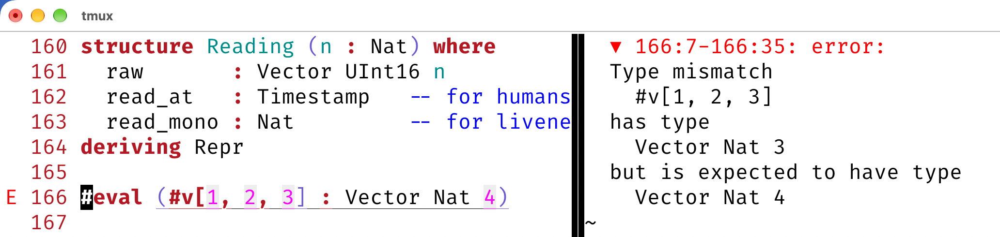
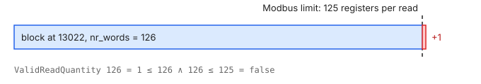
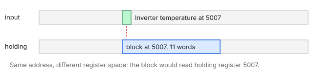
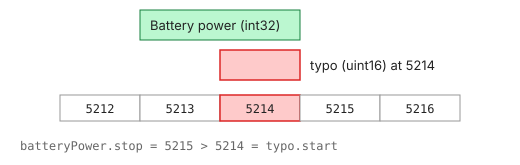
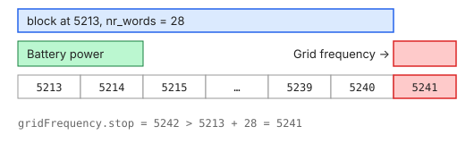

In [part 2](https://carlo-hamalainen.net/2026/10/18/sungrow-lean-part2/) we
implemented metrics and basic register reads (one at a time). Now we will
implement chunked (block) reads since this is more efficient as it involves
fewer TCP round trips. At the end, we'll also try writing to the inverter's
control registers to force the battery to charge and stop.

Recall that we modelled the sensors of the inverter using a structure:

```lean
structure Sensor where
  name                : String
  unique_id           : String
  address             : UInt16
  input_type          : InputType
  data_type           : DataType
  count               : Option Nat        := none
  swap                : Option Swap       := none
  scale               : Option JsonNumber := none
  precision           : Option Nat        := none
  -- (more fields)
```

For example, inverter temperature is encoded as:

```lean
-- `int16` with a scale of `0.1`, so a raw `253` reads as 25.3 °C.
def inverterTemperature : Sensor :=
  { name                := "Inverter temperature"
    unique_id           := "sg_inverter_temperature"
    address             := 5007
    input_type          := .input
    data_type           := .int16
    scale               := some ⟨1, 1⟩ -- 1 × 10^(-1) = 0.1
    precision           := some 1
  }
```

We want to read one of these sensors and store its result. Let's put the
reading alongside the sensor in a `Slot`:

```lean
structure Reading where
  raw       : Array UInt16
  read_at   : Timestamp     -- for humans, UTC
  read_mono : Nat           -- for liveness checks, IO.monoNanosNow

structure Slot where
  sensor    : Sensor
  reading   : Option Reading := none
```

This is fine, but how large should `raw` be? What if it's empty? Does empty
mean that the read failed? What if the field is two 16-bit words and raw has just
one? What if it's larger than the actual size of the sensor?

We can do better with dependent types:

```lean
structure Reading (n : Nat) where
  raw       : Vector UInt16 n
  read_at   : Timestamp   -- for humans, UTC
  read_mono : Nat         -- for liveness checks, IO.monoNanosNow
```

Now a reading is parameterised by `n : Nat`, and `raw` is a vector of `UInt16` of length exactly `n`.
If you try to make a vector of 3 elements and claim it is a `Vector Nat 4`, it will not compile:



(I'm using the [lean.nvim](https://github.com/julian/lean.nvim) Neovim plugin. VS Code shows the same information.)

Now the reading in a `Slot` can refer to the actual register size via the function `Sensor.words`:
```lean
def Sensor.words (s : Sensor) : Nat :=
  match s.data_type with
  | .int16  | .uint16 => 1
  | .int32  | .uint32 => 2
  | .string           => s.count.getD 1

structure Slot where
  sensor    : Sensor
  reading   : Option (Reading sensor.words) := none
```

Inverter temperature is one register, while DC power is two:

```lean
-- `uint32` spanning registers 5016 and 5017, low word first.
def totalDcPower : Sensor :=
  { name                := "Total DC power"
    unique_id           := "sg_total_dc_power"
    address             := 5016
    input_type          := .input
    data_type           := .uint32
    swap                := some .word
    scale               := some ⟨1, 0⟩
    precision           := some 0
    -- (more fields)
  }
```

We can check this with `#eval`:

```lean
#eval inverterTemperature.words   -- 1
#eval totalDcPower.words          -- 2
```

Since `Sensor.words` is an ordinary function, Lean can evaluate it while
type checking. So `Reading inverterTemperature.words` *is* `Reading 1`, and
`rfl` proves it:

```lean
example : Reading inverterTemperature.words = Reading 1 := rfl
example : Reading totalDcPower.words        = Reading 2 := rfl
```

A slot that hasn't been read yet just leaves `reading` at its default of `none`.
Notice that the type of the reading mentions the slot's own sensor:

```lean
def emptySlot : Slot := { sensor := inverterTemperature }

#check emptySlot.reading -- emptySlot.reading : Option (Reading emptySlot.sensor.words)
```

Now let's fill in some readings, giving each one exactly as many words as
its sensor needs:

```lean
def t0 : Timestamp := Timestamp.ofSecondsSinceUnixEpoch 1793050000 -- 2026-10-26T21:26:40

def tempSlot : Slot :=
  { sensor  := inverterTemperature
    reading := some { raw := #v[253], read_at := t0, read_mono := 0 } }

def dcSlot : Slot :=
  { sensor  := totalDcPower
    reading := some { raw := #v[1480, 0], read_at := t0, read_mono := 0 } }

#eval tempSlot.reading.map (·.raw.toArray)   -- some #[253]
#eval dcSlot.reading.map (·.raw.toArray)     -- some #[1480, 0]
```

If we hand the DC power sensor only one word, the definition doesn't compile:

```lean
def badSlot : Slot :=
  { sensor  := totalDcPower
    reading := some { raw := #v[1480], read_at := t0, read_mono := 0 } }
```

```text
error: Type mismatch
  #v[1480]
has type
  Vector Nat 1
but is expected to have type
  Vector UInt16 totalDcPower.words
```

The check holds up under updates too. If we take the temperature slot and
swap in a different sensor, the old one-word reading no longer matches:

```lean
def swapped : Slot := { tempSlot with sensor := totalDcPower }
```

```text
error: Type mismatch
  __src✝.reading
has type
  Option (Reading __src✝.sensor.words)
but is expected to have type
  Option (Reading totalDcPower.words)
```

The payoff comes when we read the data back. Lean knows how long `raw` is,
so it can check each index while type checking. We don't need `!` or `?`,
and there's nothing that can panic at runtime:

```lean
def tempRaw (r : Reading inverterTemperature.words) : UInt16 := r.raw[0]  -- ok
def dcHigh  (r : Reading totalDcPower.words)        : UInt16 := r.raw[1]  -- ok

def tempBad (r : Reading inverterTemperature.words) : UInt16 := r.raw[1]
```

```text
error: failed to prove index is valid, possible solutions:
  ...
r : Reading inverterTemperature.words
⊢ 1 < inverterTemperature.words
```

The temperature sensor has exactly one register, so index 1 doesn't exist,
and Lean rejects `tempBad` before it ever runs.

## Read blocks

Now let's define a read block. This has a starting `address`, from which we will read `nr_words` words, and an 
array of slots. The idea is that the range `[address, address + nr_words)` will cover any register in `slots`.

```lean
structure ReadBlock where
  input_type  : InputType -- .input | .holding
  address     : Nat
  nr_words    : Nat
  slots       : Array Slot
```

With this definition, there's nothing stopping us from creating a nonsensical
read block. There are four ways it can go wrong:

1. `nr_words` is more than Modbus allows in one read.
2. A slot's sensor is in the other register space (input vs holding).
3. Two slots claim the same register (i.e. overlap).
4. A slot sits partly or completely outside `[address, address + nr_words)`.

Rather than checking these at runtime, we make each one a field of the
structure. A field whose type is a `Prop` holds a proof, so a `ReadBlock`
value can't exist unless all four conditions hold:

```lean
def Sensor.start (s : Sensor) : Nat := s.address.toNat
def Sensor.stop  (s : Sensor) : Nat := s.start + s.words  -- [start, stop) is half-open

def Slot.sensors (slots : Array Slot) : List Sensor :=
  slots.toList.map (·.sensor)

structure ReadBlock where
  input_type  : InputType
  address     : Nat
  nr_words    : Nat
  slots       : Array Slot

  fits        : Modbus.ValidReadQuantity nr_words
  same_type   : ∀ s ∈ Slot.sensors slots, s.input_type = input_type
  disjoint    : (Slot.sensors slots).Pairwise (·.stop ≤ ·.start)
  inside      : ∀ s ∈ Slot.sensors slots,
                  address ≤ s.start ∧ s.stop ≤ address + nr_words
```

To try this out, here are two more sensors:

```lean
-- Signed: negative while the battery is charging.
def batteryPower : Sensor :=
  { name       := "Battery power"
    unique_id  := "sg_battery_power"
    address    := 5213
    input_type := .input
    data_type  := .int32
    swap       := some .word
    -- (more fields)
  }

-- Scale `0.01`: a raw `5002` is 50.02 Hz.
def gridFrequency : Sensor :=
  { name       := "Grid frequency"
    unique_id  := "sg_grid_frequency"
    address    := 5241
    input_type := .input
    data_type  := .uint16
    scale      := some ⟨1, 2⟩
    -- (more fields)
  }
```

The battery power takes registers 5213 and 5214, and the grid frequency is at
5241. So a 29-word read starting at 5213 covers both. Because the sensors are
literals, `decide` can close all four proofs: Lean just evaluates each
proposition.

```lean
def batteryBlock : ReadBlock :=
  { input_type := .input
    address    := 5213
    nr_words   := 29
    slots      := #[⟨batteryPower, none⟩, ⟨gridFrequency, none⟩]
    fits       := by decide
    same_type  := by decide
    disjoint   := by decide
    inside     := by decide }
```

Now let's break each condition in turn.

### Too many words

A single Modbus read can return at most 125 registers:

```lean
abbrev maxReadQuantity : Nat := 125
abbrev ValidReadQuantity (n : Nat) : Prop := 1 ≤ n ∧ n ≤ maxReadQuantity
```



Ask for 126 words and `fits` fails:

```text
error: Tactic `decide` proved that the proposition
  Modbus.ValidReadQuantity 126
is false
```

The Modbus client's `readInputRegisters` requires the same `ValidReadQuantity`
proof. So once a block has been built, reading it needs no extra checks.

### Wrong register space

Input and holding registers are two separate address spaces. Input register
5007 and holding register 5007 have nothing to do with each other. A block
marked `.holding` can't hold the inverter temperature, which is an input
register:



```text
error: Tactic `decide` proved that the proposition
  ∀ (s : Sensor), s ∈ Slot.sensors #[{ sensor := inverterTemperature }] → s.input_type = InputType.holding
is false
```

### Overlapping slots

Battery power is an `int32`, so it takes registers 5213 and 5214. Suppose we
mistype the grid frequency's address as 5214:

```lean
def typo : Sensor := { gridFrequency with address := 5214 }
```



`disjoint` says that each sensor has to stop at or before the start of the
next one. Here that fails:

```text
error: Tactic `decide` proved that the proposition
  List.Pairwise (fun x1 x2 => x1.stop ≤ x2.start)
    (Slot.sensors #[{ sensor := batteryPower }, { sensor := typo }])
is false
```

Since `Pairwise` compares every slot with every slot after it, the same
condition also means the slots must be in ascending address order.

### Slot outside the block

This is the valid block from above, but with an off-by-one: 28 words instead
of 29. The block now covers `[5213, 5241)`, so the grid frequency at 5241
falls just past the end:



```text
error: Tactic `decide` proved that the proposition
  ∀ (s : Sensor),
    s ∈ Slot.sensors #[{ sensor := batteryPower }, { sensor := gridFrequency }] → 5213 ≤ s.start ∧ s.stop ≤ 5213 + 28
is false
```

Without this check, the read would succeed and we would get a 28-word vector
back. Then we would try to slice register 5241 out of it, which is past the
end. The `inside` proof is what makes that slice safe.

## Slicing a block read

One Modbus request returns the whole block as a `Vector UInt16 b.nr_words`.
Now we need to cut it up, giving each slot exactly its sensor's words:

```lean
def ReadBlock.slice (b : ReadBlock) (v : Vector UInt16 b.nr_words) (i : Fin b.slots.size) :
    Vector UInt16 b.slots[i].sensor.words :=

  let s      := b.slots[i].sensor
  let offset := s.start - b.address

  have hin : b.address ≤ s.start ∧ s.stop ≤ b.address + b.nr_words := b.inside s (b.mem_sensors i)

  Vector.ofFn fun (k : Fin s.words) =>
    v[offset + k]'(by
      have hk : k.val < s.words := k.isLt
      have hstop : s.stop = s.start + s.words := rfl
      omega
      )
```

The types tell us about the constraints:

- `v : Vector UInt16 b.nr_words` is the raw block read, so it has to be
  exactly as long as the block.
- `i : Fin b.slots.size` is an index that is guaranteed to be a valid slot,
  so `b.slots[i]` needs no bounds check.
- The return type `Vector UInt16 b.slots[i].sensor.words` matches what a
  `Slot`'s `Reading` needs. That's `Reading sensor.words` from earlier.

The body works out where the sensor starts within the block, namely `offset`. Then
it builds the result with `Vector.ofFn`, which takes a function from
`Fin s.words` to elements. A vector built that way has length `s.words` by
construction, so getting the length right needs no proof. The only proof
needed is that each lookup `v[offset + k]` stays in bounds. At that point,
the goal is:

```text
s      : Sensor := b.slots[i].sensor
offset : Nat    := s.start - b.address
hin    : b.address ≤ s.start ∧ s.stop ≤ b.address + b.nr_words
k      : Fin s.words
hk     : ↑k < s.words
hstop  : s.stop = s.start + s.words
⊢ offset + ↑k < b.nr_words
```

This is linear arithmetic, and `omega` can do the proof. If we were proving it by
hand with pen and paper we would do the following:

```text
offset + k  =  (s.start - b.address) + k         -- definition of offset
            <  (s.start - b.address) + s.words   -- hk
            =  s.start + s.words - b.address     -- rearranging, needs b.address ≤ s.start (hin)
            =  s.stop  - b.address               -- hstop
            ≤  b.nr_words                        -- s.stop ≤ b.address + b.nr_words (hin)
```

The interesting hypothesis is `hin`. It comes straight from the block's
`inside` field, together with a small lemma, `mem_sensors`, which says that
`b.slots[i].sensor` is in `Slot.sensors b.slots`. Both halves of `hin` get
used. The left half matters because `Nat` subtraction truncates at zero. If
the sensor started before the block, then `s.start - b.address` would be `0`,
and the rearranging step would fail. For example, with `s.start = 5`,
`b.address = 7` and `s.words = 3`, the left side is `0 + 3 = 3` but the right
side is `8 - 7 = 1`.

Delete the `have hin` line and `omega` gives up:

```text
error: omega could not prove the goal:
a possible counterexample may satisfy the constraints
  ...
```

Without `inside`, nothing ties the sensor's position to the size of the
block, and an out-of-bounds read is a real possibility. So the proof we gave
when building the block pays off when we use it!

We can watch it work on `batteryBlock` without talking to the inverter. Instead
of real sensor values, we fill a fake read with labels: the word that came
from register 5213 is set to the number 5213, the word from 5214 is set to
5214, and so on. Then any word that `slice` returns tells us which register
it came from:

```lean
def fakeRead : Vector UInt16 batteryBlock.nr_words :=
  Vector.ofFn fun k => (5213 + k.val).toUInt16

#eval fakeRead.toArray
-- #[5213, 5214, 5215, ..., 5240, 5241]

#eval (batteryBlock.slice fakeRead ⟨0, by decide⟩).toArray   -- battery power
-- #[5213, 5214]

#eval (batteryBlock.slice fakeRead ⟨1, by decide⟩).toArray   -- grid frequency
-- #[5241]
```

The battery power gets its two registers, and the grid frequency gets the
single register at offset 28, the last word of the block.

## Reading a block

With `slice` in place, reading a block is short:

```lean
/-- Read the block's registers in one request and record a reading in every slot. -/
def ReadBlock.read (b : ReadBlock) (c : Modbus.Client) : Modbus.M ReadBlock := do
  let addr := b.address.toUInt16
  let v ← match b.input_type with
    | .input   => c.readInputRegisters   addr b.nr_words b.fits
    | .holding => c.readHoldingRegisters addr b.nr_words b.fits
  let readAt ← Timestamp.now
  let readMono ← IO.monoNanosNow

  return b.setReadings fun i => some ⟨b.slice v i, readAt, readMono⟩
```

The block's `fits` field is passed straight to the Modbus client as the proof
that `nr_words` is a legal read size. The client returns a
`Vector UInt16 b.nr_words`, which is exactly what `slice` expects. Then
`setReadings` fills in every slot. It returns a new `ReadBlock`, so it has to
supply the four proofs again. `fits` carries over unchanged, and the other
three only talk about the slots' sensors. A small lemma shows that replacing
the readings leaves `Slot.sensors` unchanged, so the old proofs still apply.

Real sensors are loaded from JSON at runtime, so they aren't literals and
`decide` can't help. Instead, `ReadBlock.make?` checks the four conditions
at runtime and returns an `Option ReadBlock`:

```lean
def ReadBlock.make? (ty : InputType) (addr n : Nat) (slots : Array Slot) : Option ReadBlock :=
  if h : (Modbus.ValidReadQuantity n)
       ∧ (∀ s ∈ Slot.sensors slots, s.input_type = ty)
       ∧ (Slot.sensors slots).Pairwise (·.stop ≤ ·.start)
       ∧ (∀ s ∈ Slot.sensors slots, addr ≤ s.start ∧ s.stop ≤ addr + n)
    then
      have ⟨fits, same_type, disjoint, inside⟩ := h
      some ⟨ty, addr, n, slots, fits, same_type, disjoint, inside⟩
    else
      none
```

The `if h : ...` form makes the check's result available as a proof `h` in
the `then` branch, and those four proofs go straight into the structure.
`Main.lean` groups the sensors greedily: it keeps adding the next sensor to
the current block for as long as `make?` succeeds, and starts a new block
when it fails.

For the 29 sensors I'm monitoring, that gives three blocks. With
`SUNGROWD_DEBUG=1` we can see the Modbus traffic (metrics trimmed, and the
last response shortened):

```shell
❯ SUNGROWD_DEBUG=1 .lake/build/bin/sungrowd
TX 00 00 00 00 00 06 01 | 04 13 8f 00 0b   mbap tx=0 len=6 unit=1
RX 00 00 00 00 00 19 01 | 04 16 01 ae 00 00 00 00 0f 19 00 19 06 7a 00 00 00 00 00 00 03 bd 00 00   mbap tx=0 len=25 unit=1
solar_inverter_temperature_celsius      43.0 °C
solar_pv_string1_voltage_volts          386.5 V
solar_pv_string1_current_amperes        2.5 A
solar_pv_string2_voltage_volts          165.8 V
solar_pv_string2_current_amperes        0.0 A
solar_pv_power_watts                    957 W
TX 00 01 00 00 00 06 01 | 04 14 5d 00 1d   mbap tx=1 len=6 unit=1
RX 00 01 00 00 00 3d 01 | 04 3a 00 e0 00 00 00 00 00 00 00 00 00 00 00 00 00 00 00 00 00 00 00 00 00 00 00 00 00 00 00 00 00 00 00 00 00 00 00 00 00 00 00 00 00 00 00 00 00 00 00 00 00 00 00 00 00 00 13 8b   mbap tx=1 len=61 unit=1
solar_battery_power_watts               224 W
solar_grid_frequency_hertz              50.03 Hz
TX 00 02 00 00 00 06 01 | 04 32 c7 00 30   mbap tx=2 len=6 unit=1
RX 00 02 00 00 00 63 01 | 04 60 00 00 00 0d 00 14 3a 77 ... 0b b7 00 00   mbap tx=2 len=99 unit=1
solar_running_state                     0 (Running)
solar_power_flow_status                 13 (PV generating, Battery discharging, Positive Load Power)
...
```

That's three round trips instead of 29. Each request is function code `04`
(read input registers), followed by a start address and a count:

| Request | Start | Count | Covers |
|---|---|---|---|
| `13 8f 00 0b` | 5007 | 11 | inverter temperature … total DC power |
| `14 5d 00 1d` | 5213 | 29 | battery power, grid frequency (our `batteryBlock`) |
| `32 c7 00 30` | 12999 | 48 | running state … total exported energy |

We can decode the first response by hand to check `slice`. After the byte
count `16` (22 bytes = 11 words), the words are:

```text
offset  0  01ae  register 5007  inverter temperature  430 × 0.1 = 43.0 °C
offset  3  0f19  register 5010  MPPT1 voltage        3865 × 0.1 = 386.5 V
offset  4  0019  register 5011  MPPT1 current          25 × 0.1 = 2.5 A
offset  5  067a  register 5012  MPPT2 voltage        1658 × 0.1 = 165.8 V
offset  9  03bd  register 5016  total DC power, low word  = 957
offset 10  0000  register 5017  total DC power, high word = 0      → 957 W
```

The second block is mostly zeros because nothing we monitor lives between
battery power and grid frequency. We read those 26 registers anyway, since
one larger request is cheaper than two small ones. The block starts with
`00e0 0000` (battery power, low word first: 224 W) and ends with `138b`
(5003 × 0.01 = 50.03 Hz).

## Write test

So far we have only read from the inverter. It also has writable holding
registers that control its energy management system (EMS). Three consecutive
registers starting at 13049 (`32 f9` in the traffic below) matter here:

| Register | Meaning | Values |
|---|---|---|
| 13049 | EMS mode | `0` self-consumption, `2` forced |
| 13050 | Forced command | `0xAA` (170) charge, `0xBB` (187) discharge, `0xCC` (204) stop |
| 13051 | Forced power | watts, used for charge and discharge |

In self-consumption mode, which is the normal setting, the inverter decides
for itself. Surplus PV charges the battery, and the battery covers the house
load when PV falls short. In forced mode, it follows the command register
instead.

Each `sungrowd write` does three Modbus requests: read the three registers
(function code `03`), write all three at once (function code `10`), and read
them back. It then prints a JSON record of what it intended, what was there
before, and what is there after. A successful write has "after" equal to
"intended".

The full output lists 29 metrics. Below, I've kept only the ones that show
where the power is going. Note the signs: battery power is negative while
the battery charges and positive while it discharges, and grid power is
positive while exporting and negative while importing.

First, check status:

```shell
❯ .lake/build/bin/sungrowd
solar_pv_power_watts                    1586 W
solar_battery_power_watts               -1208 W
solar_running_state                     0 (Running)
solar_power_flow_status                 3 (PV generating, Battery charging)
solar_load_power_watts                  260 W
solar_grid_power_watts                  0 W
solar_inverter_ac_power_watts           260 W
```

Check the control status:

```shell
❯ SUNGROWD_DEBUG=1 .lake/build/bin/sungrowd control
TX 00 00 00 00 00 06 01 | 03 32 f9 00 03   mbap tx=0 len=6 unit=1
RX 00 00 00 00 00 09 01 | 03 06 00 00 00 cc 00 00   mbap tx=0 len=9 unit=1
self_consumption stop 0 W  raw #[0, 204, 0]
```

Force it to stop:

```shell
❯ SUNGROWD_DEBUG=1 .lake/build/bin/sungrowd write forced stop
TX 00 00 00 00 00 06 01 | 03 32 f9 00 03   mbap tx=0 len=6 unit=1
RX 00 00 00 00 00 09 01 | 03 06 00 00 00 cc 00 00   mbap tx=0 len=9 unit=1
TX 00 01 00 00 00 0d 01 | 10 32 f9 00 03 06 00 02 00 cc 00 00   mbap tx=1 len=13 unit=1
RX 00 01 00 00 00 06 01 | 10 32 f9 00 03   mbap tx=1 len=6 unit=1
TX 00 02 00 00 00 06 01 | 03 32 f9 00 03   mbap tx=2 len=6 unit=1
RX 00 02 00 00 00 09 01 | 03 06 00 02 00 cc 00 00   mbap tx=2 len=9 unit=1
{"recorded_at": "2026-10-24T23:03:03Z",
 "intended":
 {"forced_power_w": 0,
  "ems_mode_label": "forced",
  "ems_mode": 2,
  "ems_command_label": "stop",
  "ems_command": 204},
 "before":
 {"forced_power_w": 0,
  "ems_mode_label": "self_consumption",
  "ems_mode": 0,
  "ems_command_label": "stop",
  "ems_command": 204},
 "after":
 {"forced_power_w": 0,
  "ems_mode_label": "forced",
  "ems_mode": 2,
  "ems_command_label": "stop",
  "ems_command": 204}}
```

Check what's happening:

```shell
❯ .lake/build/bin/sungrowd control
forced stop 0 W  raw #[2, 204, 0]


❯ .lake/build/bin/sungrowd
solar_pv_power_watts                    962 W
solar_battery_power_watts               0 W
solar_running_state                     2048 (Running in compulsory (forced) mode)
solar_power_flow_status                 17 (PV generating, Exporting Power)
solar_load_power_watts                  208 W
solar_grid_power_watts                  659 W
solar_inverter_ac_power_watts           881 W
```


Now force charge at 1230 W:

```shell
❯ SUNGROWD_DEBUG=1 .lake/build/bin/sungrowd write forced charge 1230
TX 00 00 00 00 00 06 01 | 03 32 f9 00 03   mbap tx=0 len=6 unit=1
RX 00 00 00 00 00 09 01 | 03 06 00 02 00 cc 00 00   mbap tx=0 len=9 unit=1
TX 00 01 00 00 00 0d 01 | 10 32 f9 00 03 06 00 02 00 aa 04 ce   mbap tx=1 len=13 unit=1
RX 00 01 00 00 00 06 01 | 10 32 f9 00 03   mbap tx=1 len=6 unit=1
TX 00 02 00 00 00 06 01 | 03 32 f9 00 03   mbap tx=2 len=6 unit=1
RX 00 02 00 00 00 09 01 | 03 06 00 02 00 aa 04 ce   mbap tx=2 len=9 unit=1
{"recorded_at": "2026-10-24T23:04:07Z",
 "intended":
 {"forced_power_w": 1230,
  "ems_mode_label": "forced",
  "ems_mode": 2,
  "ems_command_label": "charge",
  "ems_command": 170},
 "before":
 {"forced_power_w": 0,
  "ems_mode_label": "forced",
  "ems_mode": 2,
  "ems_command_label": "stop",
  "ems_command": 204},
 "after":
 {"forced_power_w": 1230,
  "ems_mode_label": "forced",
  "ems_mode": 2,
  "ems_command_label": "charge",
  "ems_command": 170}}


❯ .lake/build/bin/sungrowd
solar_pv_power_watts                    962 W
solar_battery_power_watts               -1229 W
solar_running_state                     2048 (Running in compulsory (forced) mode)
solar_power_flow_status                 43 (PV generating, Battery charging, Positive Load Power, Importing Power)
solar_load_power_watts                  1726 W
solar_grid_power_watts                  -2140 W
solar_inverter_ac_power_watts           -420 W
```

The battery is charging at 1229 W, right on the 1230 W target, even though
the load is now higher than the PV output. Our washing machine was running,
which explains the 1726 W load, so most of the 2140 W grid import is for
the washing machine, not the battery. The part going to the battery shows up
in the inverter's AC power: −420 W means the inverter is drawing about 420 W
from the grid to top up the 962 W of PV.

And finally, revert to self-consumption mode:

```shell
❯ SUNGROWD_DEBUG=1 .lake/build/bin/sungrowd write self-consumption
TX 00 00 00 00 00 06 01 | 03 32 f9 00 03   mbap tx=0 len=6 unit=1
RX 00 00 00 00 00 09 01 | 03 06 00 02 00 aa 04 ce   mbap tx=0 len=9 unit=1
TX 00 01 00 00 00 0d 01 | 10 32 f9 00 03 06 00 00 00 cc 00 00   mbap tx=1 len=13 unit=1
RX 00 01 00 00 00 06 01 | 10 32 f9 00 03   mbap tx=1 len=6 unit=1
TX 00 02 00 00 00 06 01 | 03 32 f9 00 03   mbap tx=2 len=6 unit=1
RX 00 02 00 00 00 09 01 | 03 06 00 00 00 cc 00 00   mbap tx=2 len=9 unit=1
{"recorded_at": "2026-10-24T23:04:49Z",
 "intended":
 {"forced_power_w": 0,
  "ems_mode_label": "self_consumption",
  "ems_mode": 0,
  "ems_command_label": "stop",
  "ems_command": 204},
 "before":
 {"forced_power_w": 1230,
  "ems_mode_label": "forced",
  "ems_mode": 2,
  "ems_command_label": "charge",
  "ems_command": 170},
 "after":
 {"forced_power_w": 0,
  "ems_mode_label": "self_consumption",
  "ems_mode": 0,
  "ems_command_label": "stop",
  "ems_command": 204}}


❯ .lake/build/bin/sungrowd
solar_pv_power_watts                    961 W
solar_battery_power_watts               353 W
solar_running_state                     0 (Running)
solar_power_flow_status                 13 (PV generating, Battery discharging, Positive Load Power)
solar_load_power_watts                  1252 W
solar_grid_power_watts                  0 W
solar_inverter_ac_power_watts           1252 W
```

The washing machine is still running, but now the inverter covers the load
from PV plus 353 W from the battery, and imports nothing from the grid.

All four readings side by side:

| | Self-consumption | Forced stop | Forced charge 1230 W | Self-consumption |
|---|---|---|---|---|
| Running state | 0 (Running) | 2048 (forced) | 2048 (forced) | 0 (Running) |
| PV | 1586 W | 962 W | 962 W | 961 W |
| Battery | −1208 W | **0 W** | **−1229 W** | +353 W |
| Load | 260 W | 208 W | 1726 W | 1252 W |
| Grid | 0 W | +659 W | −2140 W | 0 W |
| Inverter AC | 260 W | 881 W | −420 W | 1252 W |

- **Forced stop:** the battery does nothing, and the PV surplus that was
  going into it now goes out to the grid.
- **Forced charge:** the battery charges at the requested rate and takes
  some power from the grid to do so. In self-consumption mode it never would.
- **Back to self-consumption:** with the same washing machine load, the
  battery discharges to cover it and the grid sits at 0 W.

## Summary

Dependent types helped us in two ways:

- A `Reading` has exactly as many words as its sensor needs. A reading
  of the wrong length doesn't compile, and indexing into a reading needs no
  runtime bounds checks.
- A `ReadBlock` has proofs that its read size is legal and that every
  slot fits inside it. Those proofs come from `decide` for literal sensors,
  and from `make?` for sensors loaded at runtime. The `slice` function uses these proofs
  to cut one Modbus response into per-sensor readings with no bounds checks.

We reduced 29 queries to 3 using block reads, and saw that control register
writes successfully modify the inverter's mode.


Full source code is at <https://github.com/carlohamalainen/sungrowd-lean>.

